# LyricsPipeline

S3 audio → Fargate Spot vocal separation → Amazon Transcribe → word timestamps for karaoke.
Infrastructure uses **three independently deployed Pulumi Go projects**, sharing one Go module.
You can deploy and test transcription without deploying separation, ECS, a VPC or a NAT gateway.

| Project / directory | Resources | Dependency |
| --- | --- | --- |
| `LyricsPipeline` / `infra/base` | Private encrypted S3 bucket, extraction SQS queue/DLQ, S3 notification and queue permission | None |
| `LyricsPipeline-Separation` / `infra/separation` | VPC/NAT, ECR, IAM, ECS Fargate Spot, logs, native autoscaling | Base stack |
| `LyricsPipeline-Transcription` / `infra/transcription` | EventBridge rules, Step Functions Standard, two small Go Lambdas, IAM, error queue, alarms | Base stack |

```mermaid
flowchart LR
    Input["S3 input/job_id/audio.mp3"] --> Queue["SQS: separation"]
    Queue --> Worker["Fargate Spot worker"]
    Worker --> Vocals["S3 output/job_id/vocals.wav"]
    Vocals --> Events["EventBridge: Object Created"]
    Events --> Workflow["Step Functions Standard"]
    Workflow --> Prepare["Lambda: validate source / reuse result"]
    Prepare --> Transcribe["Amazon Transcribe: en-US"]
    Transcribe --> Managed["AWS-managed output"]
    Managed --> Normalize["Lambda: archive JSON and normalize timestamps"]
    Normalize --> Raw["S3: raw.json"]
    Normalize --> Transcript["S3: transcript.json"]
```



The base owns **one** S3 notification configuration: the existing input-prefix S3 → SQS
notification plus EventBridge enabled on the same resource. Transcription owns its own
EventBridge rules; it never edits bucket notifications. Output JSON and extraction manifests
do not match the vocals rule. Transcription starts as soon as `vocals.wav` is written,
without waiting for the extraction manifest.

See [worker behavior](vocal-extractor/README.md), [transcription behavior and JSON contract](transcription/README.md),
and [infrastructure conventions](INFRASTRUCTURE_RULES.md).

The local [Astro + React lyrics viewer](frontend/README.md) plays `mocks/rick.mp3`
with word-level karaoke highlighting from `mocks/transcript.json`. Run
`cd frontend && npm ci && npm run dev` to open it locally.

## Configuration and layer interfaces

Each project's `Pulumi.yaml` is the source of its shared settings. Stack files contain only
intentional overrides, `baseStack` references and the published worker `image`. Pulumi resolves
project values and whole-key stack overrides natively; objects are **not deep merged**.
Go validates the resolved configuration and never supplies application default values.

Each layer has its own `main.go`, `config.go` and `deployment.go`. Its local
`deploy(ctx)` reads and validates configuration, resolves dependencies, composes resources
and exports results. The Go module remains at the repository root.

```text
infra/
  base/           # S3, queues, bucket notification wiring
  separation/     # worker container, permissions, network and ECS composition
  transcription/  # Transcribe workflow, events, permissions and Lambda environment
  contracts/      # versioned base outputs and explicit StackReference reader
internal/
  config/         # strict JSON decoding; no application configuration model
  lambdabuild/    # Go compilation and deterministic ZIP; no Pulumi or AWS
  lambda/         # Lambda resource from an existing artifact and explicit AWS inputs
  iam/            # roles and caller-supplied policies
  ecs/            # ECS resources from supplied container definitions and networking
  ...             # service components: vpc, s3, sqs, ecr, autoscaling
```

Resource packages receive their own settings, IDs, ARNs and readiness dependencies.
Separation defines the worker's environment and file permissions; transcription defines
its workflow, application permissions and `TRANSCRIPTION_ACTION`. Historical component
tokens and names are declared by the owning layers to preserve existing resource identities.

Both transcription Lambdas are native Go executables on `provided.al2023` / ARM64.
The transcription Pulumi program builds the shared `bootstrap` and a reproducible ZIP in
ignored `bin/transcription/` during preview/deployment. It uses the Go toolchain already
required by Pulumi, with `CGO_ENABLED=0`, and needs no Docker or worker image build.
`lambdabuild.Build(ctx, Args{ModuleDir, Package, OutputDir, Architecture})` supports Linux
`arm64` and `amd64`, returning the ZIP path and Go architecture. Callers supply AWS Lambda's
architecture (`arm64` or `x86_64`) when creating a function. The transcription layer builds
once and passes the same artifact to both functions; there is no application-level build cache.

The version-1 base outputs are `contractVersion`, `accountId`, `region`, `mediaBucket`,
`mediaBucketArn`, `inputPrefix`, `outputPrefix`, `queueUrl`, `queueArn`, and `queueName`.
Consumers use `StackReference`, validate the version/account/region against the AWS provider,
and pass unresolved outputs through typed inputs so previews can register the whole graph.
Neither downstream layer references the other. Updating transcription does not update or
start the extraction service.

Prefix changes require updating consumers after the base; they are not a data migration.
Keep job IDs immutable. New audio or a new pipeline version requiring regeneration uses a new job ID.
Do not replace a previous job's `vocals.wav`: the transcription layer pins its source ETag.

## Fresh deployment: base and transcription only

The examples use `maciejpvp` and `dev`; replace the organization/environment for another deployment.
AWS credentials must belong to the target account. `aws:region` defaults to `eu-central-1`.

```bash
pulumi -C infra/base stack select dev --create
pulumi -C infra/base preview --stack dev --diff
pulumi -C infra/base up --stack dev

pulumi -C infra/transcription stack select dev --create
pulumi -C infra/transcription config set baseStack maciejpvp/LyricsPipeline/dev --stack dev
pulumi -C infra/transcription preview --stack dev --diff
pulumi -C infra/transcription up --stack dev
```

This provisions storage, queues and serverless ASR resources. It provisions no ECS, VPC or NAT.
Transcribe, Step Functions, S3, Lambda, logs and EventBridge usage can incur charges.
The extraction input queue is provisioned in the base but does not run any workers by itself.

Upload a WAV vocal stem to `s3://<mediaBucket>/output/<new-job-id>/vocals.wav`.
Read `mediaBucket` from `pulumi -C infra/base stack output mediaBucket --stack dev`. EventBridge delivery
is asynchronous; after enabling S3 EventBridge, allow several minutes for activation.
Existing objects do not generate retroactive events.

To process an **already uploaded** stem without uploading again:

```bash
python3 -m pip install -r scripts/requirements.txt
python3 scripts/run-transcription.py \
  --stack maciejpvp/LyricsPipeline-Transcription/dev \
  --s3-key output/asr-test-001/vocals.wav
```

The command prints the execution ARN and result URI. Inspect the execution in Step Functions;
no deployment or separation is performed. Repeating it reuses the completed result or the same
Transcribe job. After fixing the cause of a failed Transcribe job, pass `--attempt retry-1` to
create a new provider job. Successful results remain immutable; use a new job ID to compare runs.

Future transcription changes require only:

```bash
pulumi -C infra/transcription preview --stack dev --diff
pulumi -C infra/transcription up --stack dev
```

## Optional separation deployment

Deploy the base first, then select/init the separation stack and set its base reference.
The default service remains Fargate Spot only, minimum 0 / maximum 2 tasks, 2 vCPU / 8 GiB.
There is no On-Demand fallback. Native scaling adds one worker per threshold of five waiting
jobs per ready worker, with a 300-second cooldown; scale-in requires five empty minutes,
including no in-flight jobs. Missing metrics do not imply an empty queue.

```bash
pulumi -C infra/separation stack select dev --create
pulumi -C infra/separation config set baseStack maciejpvp/LyricsPipeline/dev --stack dev
pulumi -C infra/separation preview --stack dev --diff
pulumi -C infra/separation up --stack dev
./scripts/publish-vocal-extractor-image.sh dev
pulumi -C infra/separation preview --stack dev --diff
pulumi -C infra/separation up --stack dev
```

For a fresh environment without a published image, keep `image` empty until publishing.
An empty image selects the provisioning-only ECR `:bootstrap` reference; the real image is
required before processing input jobs. The checked-in development override retains the
previously configured digest. The publisher targets the separation project and explicit stack,
uses its configured region, builds only `vocal-extractor`, and saves only the image digest.
The stack has no Docker build dependency. NAT charges continue while separation is provisioned,
even with zero ECS tasks.

## Existing layered deployment: source directory refactor

The base project has moved to `infra/base`; all three Pulumi project names are unchanged.
Use `pulumi -C infra/base ...` for the existing base stack. Moving the source directory
requires no state move. Each layer retains its component tokens, logical names, parents,
inputs, dependencies and outputs. Preview all three projects before applying changes;
this refactor should propose no resource replacement or deletion against populated states.

## Existing monolithic deployment: migrate ownership first

**Do not run the new base program against a populated monolithic state before moving its
separation resources.** Otherwise its preview will propose deleting resources now owned by
separation. Do not create replacement infrastructure to compensate for missing state.

At planning time, `maciejpvp/LyricsPipeline/dev` reported zero resources. That does not prove
that no AWS resources exist: confirm the backend, account and owning stack first. If resources
exist outside the selected state, recover their owner or explicitly import them before proceeding.
The migration helper refuses an empty/incomplete source graph and a populated destination.

For a populated source stack:

1. Stop concurrent updates. Confirm the intended source and AWS account. Save a Git/config backup.
2. Initialize an empty separation stack with `pulumi -C infra/separation stack init dev`.
3. Inspect the planned state move:

   ```bash
   python3 scripts/split-pulumi-stacks.py \
     --source maciejpvp/LyricsPipeline/dev \
     --dest maciejpvp/LyricsPipeline-Separation/dev
   ```

4. Run the same command with `--apply` after reviewing the six component roots. The helper backs
   up both exported states and local stack configurations to a private temporary directory,
   preserves native separation overrides/image, and uses `pulumi state move` for the components
   and their children. It does not call `pulumi up`. Bucket, queue, policy and notification stay
   in the original base. Logical names, tokens, parents and physical IDs are preserved.
5. Preview the base: existing resources must have no deletes/replacements; the intended change
   is enabling EventBridge and publishing the base contract. Apply that reviewed base update
   so the separation reference has real outputs. Then preview separation: it must show no
   resource creation/deletion/replacement or ECS task-definition change. Review provider JSON
   canonicalization separately from effective behavior. Apply to persist the new outputs.
6. Deploy transcription independently as above. Keep migration backups until both states and
   physical IDs are verified. If a step fails, inspect both states; do not blindly restore just
   one side after a successful move.

The historical `migrate-pulumi-config.py` handles the pre-native `deployment` format and must
be used on the pre-split project revision before this state split. The split helper explicitly
rejects that old format; neither runtime silently interprets legacy configuration.

## Verification

```bash
go test ./...
go vet ./...
go test -race ./infra/... ./internal/... ./transcription/...
python3 -m unittest discover -s scripts/tests -v
python3 -m pytest -q vocal-extractor/tests
```

The original 44-resource fixture remains unchanged as historical evidence. Each layer
also has a `testdata/resource_graph.json` captured before this refactor: 10 base, 35 separation
and 29 transcription registrations (including components and consumer references). Layer-local
tests compare exact identities, parents, inputs, dependency sets, `ignoreChanges` and exports.
IAM JSON ordering and checkout-dependent artifact paths are normalized. Shared test helpers
know only the provider/graph format; application fixtures stay with their layers.

Tests cover ownership, stack contracts, unknown preview outputs, strict configuration,
event filters, IAM, workflow SDK parameters/retries and native Spot scaling decisions.
The generic builder is tested with two unrelated programs on ARM64 and AMD64, reproducible
archives, executable ZIP entries, changed sources and build failures. Go runtime tests cover
word normalization, immutable sources and recovery after failure. Python tests cover the
extraction worker and helper scripts.

Cloud acceptance still requires uploading a real stem with separation absent, inspecting raw
and normalized results, replaying an event, testing a failed job/retry, and checking the error
queue/alarms. Listen to several English songs, including rapid vocals and sustained notes;
compare word timestamps and the vocal stem's timeline against the original track. Valid JSON
and successful API calls do not prove karaoke alignment quality. No audio is trimmed by ASR.

### Refactor validation on 2026-10-31

- All 74 mock registrations match the pre-refactor layer snapshots: identities,
  parents, inputs, dependency sets, ignored properties and stack exports.
  The original root 44-resource fixture is unchanged.
- `go test ./...`, `go vet ./...`, race tests for all infrastructure/shared packages
  and the Go runtime, 14 helper-script tests, 30 extraction tests and `git diff --check`
  passed. Builder tests cover two entry programs, ARM64/AMD64, reproducibility and
  source edits without stale artifacts.
- The [base preview from its new directory](https://app.pulumi.com/maciejpvp/LyricsPipeline/dev/previews/055f937e-b91c-4b69-848f-83e968f03458)
  passed against the accessible empty `dev` state: 11 creates, no ECS/VPC/NAT resources.
- Provider-backed CLI previews passed for all three projects in an isolated **local
  backend with synthetic base outputs**: base 11, transcription 29, separation 35 creates.
  This verifies program/provider execution and packaging, not a migration of populated
  cloud state or access to real media objects.
- Direct previews of separation/transcription `dev` reported `no stack named 'dev' found`.
  Their Cloud stacks have not been initialized. No `pulumi up`, cloud state move,
  real-audio transcription or listening assessment was performed.
