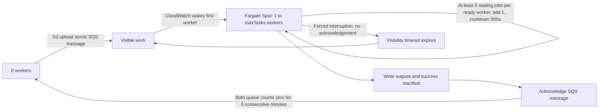

# LyricsPipeline

Pulumi infrastructure and a CPU-only S3/SQS vocal extraction worker. See [the worker README](vocal-extractor/README.md) for job inputs, output manifests, container startup, and image publishing.

## Scale to zero with Fargate Spot



Defaults: `minTasks=0`, `maxTasks=2`, `idleMinutes=5`, `backlogPerWorker=5`, `scaleOutCooldownSeconds=300`, `maxReceiveCount=5`, 2 vCPU and 8 GiB per task. Validation requires `minTasks>=0`, `maxTasks>=1`, `maxTasks>=minTasks`, `maxReceiveCount>=2`, `idleMinutes>=1`, `backlogPerWorker>=1`, and `scaleOutCooldownSeconds>=1`.

Only `FARGATE_SPOT` is associated with the cluster and used by the service (`weight=1`, `base=0`, no `LaunchType`). No On-Demand fallback is configured. AWS requires a forced deployment for a launch-type migration, so the service has `forceNewDeployment` and a stable strategy trigger. Existing resource names remain unchanged; the three redundant `messages-over-*` alarms are removed. Creation dependencies run from capacity-provider association through service and scaling target to policies. Initial desired capacity is `minTasks`; Pulumi ignores subsequent `desiredCount` changes so autoscaling owns it.

The existing visible-message alarm now uses [CloudWatch metric math](https://docs.aws.amazon.com/AmazonECS/latest/developerguide/service-autoscaling-queue.html) with SQS counts and `DesiredTaskCount`, `RunningTaskCount`, and `PendingTaskCount` from standard Container Insights, enabled on the cluster. All input periods are 60 seconds. Visible, in-flight, desired and pending use `Maximum`; running uses `Minimum` so a transition minute is not mistaken for fully available capacity. One alarm adds **one** task when demand is `>=backlogPerWorker`, with a shared 300-second cooldown for bootstrap and later increases:

- At zero reported capacity (all desired/running/pending counts zero or absent), positive visible work and an explicitly reported in-flight zero produce demand equal to the threshold. A single file can wake the first worker without ECS metrics at zero.
- With `running=desired>0` and `pending=0`, demand is `visible/running`. A worker's active job is excluded: one worker needs 5 waiting jobs, two need 10, three need 15. Raising `maxTasks` needs no new alarms.
- Reported starting capacity, partial/missing readiness metrics, or deployment overlap suppress expansion. Missing visible data produces no demand; missing in-flight data prevents bootstrap. Normal expansion only needs visible and the three ECS counts.

No Lambda, schedule, custom metric publisher or state database is involved. At the measured four minutes per job, a worker processes about 2.5 jobs per ten minutes; five waiting jobs represent about twenty minutes of queued work per worker. This is a backlog threshold, not a ten-minute completion guarantee or a message-age trigger.

Scale-in sets **exactly `minTasks`**, using five consecutive one-minute periods by default. It requires both visible and in-flight message counts to be zero. Missing data does not count as empty: expression `FILL(visible, 1) + FILL(in_flight, 1)` blocks scale-in when either count is absent, and the alarm also treats missing results as non-breaching. Metrics are approximate; alarm evaluation and ECS shutdown mean this is not an exact wall-clock shutdown deadline. ECS metric gaps at zero are intentionally treated as zero only for bootstrap; CloudWatch cannot distinguish a complete ECS telemetry outage from zero capacity. The in-flight check and shared cooldown reduce premature repeated scale-out, but delayed metrics cannot provide a strict instantaneous capacity guarantee.

Cold-start latency includes SQS/CloudWatch metrics, alarm evaluation, container/image/model startup, and Spot availability. After more than six hours of inactivity, [SQS metrics may resume with up to 15 minutes of delay](https://docs.aws.amazon.com/AWSSimpleQueueService/latest/SQSDeveloperGuide/monitoring-using-cloudwatch.html). No Lambda is involved. If [Spot capacity is unavailable](https://docs.aws.amazon.com/AmazonECS/latest/developerguide/fargate-capacity-providers.html), messages wait subject to SQS retention while ECS retries task placement. Scaling to zero does **not** stop NAT gateway or other retained infrastructure charges; networking is unchanged.

SIGTERM stops new polling while the active message can finish within `stopTimeout=120`. Late long-poll receipts are returned with visibility zero. Forced termination leaves the message unacknowledged until visibility expires; the worker checks the manifest on retry and skips completed jobs. A matching job is never acknowledged before its success manifest is saved. By default, after five unsuccessful deliveries SQS moves the message to the DLQ. Processing is at least once, with no exactly-once guarantee and no new locking system.

## Existing-stack configuration migration

Code defaults fill omitted fields, so existing stacks automatically use `backlogPerWorker=5` and `scaleOutCooldownSeconds=300` on the next deployment unless explicitly configured. Resource names, the scaling target, and the two alarms are retained; the cluster setting, scale-out cooldown, and visible-message alarm inputs change in place. Existing saved `minTasks=1` or `maxReceiveCount=1` values are not automatically migrated; the latter fails validation. Select the intended stack, inspect its configuration, and merge only the desired values into the existing `deployment` JSON. Do not replace an existing deployment object with the example, which would overwrite custom settings.

Run from the repository root with the intended stack selected (`pulumi stack select <stack>`):

```bash
# jq updates just these fields, retaining every other deployment setting.
# A failing config read/jq command stops before any configuration write.
(
  set -eu
  existing_deployment="$(pulumi config get deployment)"
  updated_deployment="$(printf '%s' "$existing_deployment" | jq -ce '
    if type == "object" then
      . + {minTasks: 0, maxReceiveCount: 5, idleMinutes: 5, backlogPerWorker: 5, scaleOutCooldownSeconds: 300}
    else error("deployment must be a JSON object") end
  ')"
  pulumi config set deployment "$updated_deployment"
)
pulumi config get deployment
pulumi preview
```

This preserves `maxTasks`, CPU, memory, visibility, region, image, tags and all other fields. The separate `deploymentImage` setting also remains unchanged. Review the preview for standard Container Insights, the shared scale-out cooldown and metric-math alarm. For stacks predating the Spot migration, also review Spot association/strategy, retry policy and deletion of the three redundant alarms. No unrelated network or storage replacement is intended. Existing desired capacity is left to autoscaling and can take the idle window to fall to zero. Deploy separately through the normal review process; implementation and local verification do not create AWS resources or run `pulumi up`.

For a new stack, initialize `deployment` from [deployment.example.json](deployment.example.json) instead. Publish a real worker image as described in the worker README before expecting processing to work; the bootstrap reference is only a provisioning placeholder.

## Verification

From the repository root:

```bash
gofmt -w config.go main.go components/*.go *_test.go
go test ./...
go vet ./...
python -m pytest -q vocal-extractor/tests
pulumi preview
```

The Go suite uses Pulumi mocks to verify configuration, resource inputs, dependency order, desired-count ownership, Spot strategy, Container Insights, the two alarms, shared cooldown, retry count and stop timeout. Synthetic metric samples evaluate the emitted expressions for bootstrap, backlog boundaries, multiple workers, starting capacity, partial/missing inputs, deployment overlap and idle windows. Python tests send SIGTERM during polling and active processing, check manifest-before-ack ordering, simulate forced interruption and redelivery, and skip a job completed before a lost acknowledgement. Mock/simulated tests do not prove AWS placement, metric/alarm timing, cooldown enforcement or actual SQS redrive behavior.

After a separately authorized deployment, verify in the target AWS environment:

1. Confirm the service has desired/running count zero and uses only `FARGATE_SPOT`. Upload a unique input audio object and record its SQS message and alarm transition.
2. Observe desired capacity rise from zero to one, Spot task placement, successful output stems and `output/{job_id}/manifest.json`, then message acknowledgement. Record visible/in-flight and desired/running/pending throughout; desired should remain one for this single file, including pending and active processing. Distinguish metric wake-up delay, container startup, and lack of Spot capacity.
3. Observe both visible and in-flight metrics report zero for five consecutive minute periods and the empty alarm set desired count to zero. Check in-flight work and missing metrics do not trigger shutdown.
4. In a separate run, interrupt a long-running test task before its manifest is written. If testing forced termination, ensure the task cannot finish within its 120-second grace period. Confirm no acknowledgement, visibility expiry, a later delivery, and eventual success. Redeliver an already completed job and confirm `job_duplicate` with no reprocessing. Separately verify a persistently failing test message reaches the DLQ after five deliveries.
5. With one ready worker, compare four versus five waiting messages. Observe one additional task only at the threshold and no further increase during startup/cooldown. In a separate stack with `maxTasks>=3`, compare nine versus ten waiting messages with two ready workers. Record actual alarm samples and scaling activities; use sufficiently long jobs so the queue remains above the threshold while metrics are published.

Validation (2026-10-30): Go formatting, `go test ./...`, `go vet ./...`, and all 15 Python tests passed. The exact emitted scale-out expression was also evaluated through AWS CloudWatch `GetMetricData`, using constant input series and absent metrics: all nine scenarios passed (bootstrap, both sides of the one/two-worker boundaries, pending, missing pending/all metrics, and in-flight work before ECS metrics). This was read-only and published no metrics.

[`pulumi preview --stack dev --non-interactive --diff`](https://app.pulumi.com/maciejpvp/LyricsPipeline/dev/previews/99e80867-f447-4e62-9616-cbd1e04c47c7) passed: three in-place updates (Container Insights, scale-out cooldown, and visible-message alarm), 42 resources unchanged, no creates/deletes/replacements. No `pulumi up` was run. Real upload, alarm/cooldown timing and post-deployment checks remain unverified until deployment.
