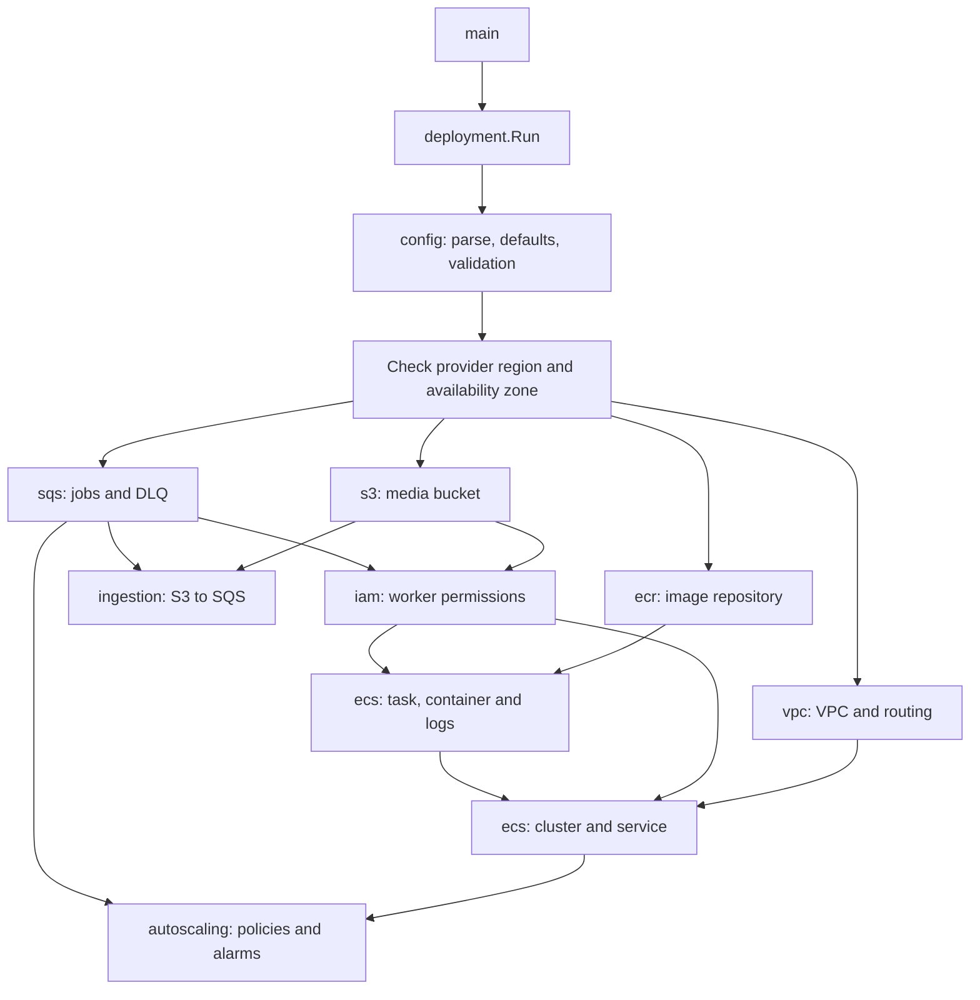
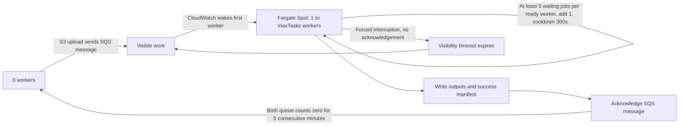

# LyricsPipeline

Pulumi infrastructure and a CPU-only S3/SQS vocal extraction worker. See [the worker README](vocal-extractor/README.md) for job inputs, output manifests, container startup, and image publishing.

## Go infrastructure layout

The project keeps one stack per environment. `main.go` delegates to
[`deployment.Run`](internal/deployment/deployment.go), which loads and validates
configuration, checks the effective AWS provider region and availability zone,
and connects components through typed outputs and explicit readiness dependencies.



Shared configuration has one source: [`Pulumi.yaml`](Pulumi.yaml). Pulumi resolves
project values and explicit stack overrides before starting the Go program. The
loader reads the effective values into typed structs, converts units and validates
them. Go contains no `Defaults()` function or fallback application values. Missing
settings or object fields are errors, including fields where zero is valid.

All workload settings are visible in the project file: VPC layout, object prefixes,
ECS resources/lifecycle/health checks, SQS polling/retention and scaling limits.
Provider protocol constants and validation constraints remain in Go. Object prefixes
flow to IAM, S3 notifications and the worker environment from the same typed layout.
Provider JSON documents use concrete structs or the IAM policy builder, with typed
`pulumix` callbacks.

Resource packages use AWS service names: `s3`, `sqs`, `ecr`, `iam`, `vpc`, `ecs`
and `autoscaling`. `config`, `deployment` and `ingestion` describe configuration
or cross-service orchestration. The `ecs` package keeps
[`NewTaskDefinition`](internal/ecs/task_definition.go) and
[`NewService`](internal/ecs/service.go) in separate files with distinct argument
structs. SDK imports use explicit aliases such as `awsecs` when names overlap.

The Go name `ecs.TaskDefinition` replaces `Image`, while the historical Pulumi
token stays `lyrics:image:Image`; `ecs.Service` retains `lyrics:worker:Worker`.
S3/SQS wiring retains its queue parent. The resource-graph regression test preserves all 44 pre-refactor component/resource
identities, inputs and original dependencies. Additional tests check IAM scopes,
container JSON, image selection, shared prefixes and creation readiness.
See [Infrastructure Rules](INFRASTRUCTURE_RULES.md) for conventions and ownership.

## Stack configuration

Edit shared workload values in [`Pulumi.yaml`](Pulumi.yaml). They apply to a fresh
stack automatically. [`Pulumi.dev.yaml`](Pulumi.dev.yaml) contains no copies of those
values: its empty `config` block inherits the project configuration. It is reserved
for intentional environment differences and the published image reference.

| Setting | Owner |
| --- | --- |
| `aws:region`, `name`, `tags` | Shared project values |
| `vpc` | Availability zone, VPC/subnet CIDRs and internet route |
| `s3` | Input and output object prefixes |
| `ecs` | Numeric CPU/MiB, stop timeout, log retention and health check |
| `sqs` | Visibility, retries, long polling and dead-letter retention |
| `autoscaling` | Task limits, idle window, backlog and both cooldowns |
| `image` | Empty project value for bootstrap; published stack digest |

Project objects use a `value:` wrapper and no project prefix; stack objects use
`LyricsPipeline:<key>:` without the wrapper. This is native
[Pulumi project-level configuration](https://www.pulumi.com/docs/iac/concepts/config/#project-level-configuration).
The runtime remains Go; YAML provides values, not resource declarations.

For normal shared-setting changes:

```bash
pulumi stack select dev
# Edit the desired value in Pulumi.yaml, e.g. autoscaling.value.maxTasks.
git diff -- Pulumi.yaml
pulumi config get autoscaling
pulumi preview
```

Pulumi's CLI currently writes stack settings, not shared project settings. An
explicit stack key replaces the entire project key: objects are not deep-merged.
For a deliberate service override, provide the complete object in the stack file.
Missing fields fail validation instead of being filled by hidden Go defaults.
Keep ordinary shared changes in the project file to avoid unnecessary stack copies.

The image is a separate scalar because it changes per deployment. Publishing it
must not replace the whole `ecs` object and discard inherited CPU/health settings:

```bash
pulumi config set image <repository-url>@<digest>
```

The publishing script performs that update automatically and reads `aws:region`
from the effective Pulumi configuration. Empty `image` selects ECR `:bootstrap`
for provisioning; processing requires a real published image.

For a new environment, initialize/select its stack through the normal workflow.
It inherits the project values; only intentional differences belong in
`Pulumi.<stack>.yaml`. Keep project/shared stack settings in version control, as
recommended by [Pulumi](https://www.pulumi.com/docs/iac/concepts/projects/stack-settings-file/).
Use secret configuration APIs and encrypted stack values for future sensitive data.

### Migrate an existing deployment object

The old flat `deployment` object and `deploymentImage` override are no longer read.
If either key is still present, the program stops with a migration message instead
of silently provisioning with defaults. From the project root, migrate the intended
existing stack:

```bash
python3 scripts/migrate-pulumi-config.py --stack <stack>
pulumi config --stack <stack>
pulumi preview --stack <stack>
```

The script uses the Pulumi CLI and Python standard library. It converts old CPU/RAM
strings into numeric units, preserves configured task/queue/scaling limits and tags,
and moves the effective image to `image` (the old published override takes
precedence). It reads project values using the Pulumi CLI, builds complete override
objects only for actual differences, and removes redundant copies from the stack.
It refuses conflicting settings and leaves unrelated keys, encrypted values and
secret-provider metadata intact. If a configuration write fails, it restores
the original local stack file. Legacy keys are removed only after the new objects
have been saved. Re-running the script after success does nothing. It does not run
`pulumi up` or create resources. A custom settings path can be passed with
`--config-file`.

## Scale to zero with Fargate Spot



Defaults: `minTasks=0`, `maxTasks=2`, `idleMinutes=5`, `backlogPerWorker=5`, `scaleOutCooldownSeconds=300`, `maxReceiveCount=5`, 2 vCPU and 8 GiB per task. Validation requires `minTasks>=0`, `maxTasks>=1`, `maxTasks>=minTasks`, `maxReceiveCount>=2`, `idleMinutes>=1`, `backlogPerWorker>=1`, and `scaleOutCooldownSeconds>=1`.

Only `FARGATE_SPOT` is associated with the cluster and used by the service (`weight=1`, `base=0`, no `LaunchType`). No On-Demand fallback is configured. AWS requires a forced deployment for a launch-type migration, so the service has `forceNewDeployment` and a stable strategy trigger. Existing resource names remain unchanged; the three redundant `messages-over-*` alarms are removed. Creation dependencies run from capacity-provider association through service and scaling target to policies. Initial desired capacity is `minTasks`; Pulumi ignores subsequent `desiredCount` changes so autoscaling owns it.

The existing visible-message alarm now uses [CloudWatch metric math](https://docs.aws.amazon.com/AmazonECS/latest/developerguide/service-autoscaling-queue.html) with SQS counts and `DesiredTaskCount`, `RunningTaskCount`, and `PendingTaskCount` from standard Container Insights, enabled on the cluster. All input periods are 60 seconds. Visible, in-flight, desired and pending use `Maximum`; running uses `Minimum` so a transition minute is not mistaken for fully available capacity. One alarm adds **one** task when demand is `>=backlogPerWorker`, with a shared 300-second cooldown for bootstrap and later increases:

- At zero reported capacity (all desired/running/pending counts zero or absent), positive visible work and an explicitly reported in-flight zero produce demand equal to the threshold. A single file can wake the first worker without ECS metrics at zero.
- With `running=desired>0` and `pending=0`, demand is `visible/running`. A worker's active job is excluded: one worker needs 5 waiting jobs, two need 10, three need 15. Raising `maxTasks` needs no new alarms.
- Reported starting capacity, partial/missing readiness metrics, or deployment overlap suppress expansion. Missing visible data produces no demand; missing in-flight data prevents bootstrap. Normal expansion only needs visible and the three ECS counts.

No Lambda, schedule, custom metric publisher or state database is involved. At the measured four minutes per job, a worker processes about 2.5 jobs per ten minutes; five waiting jobs represent about twenty minutes of queued work per worker. This is a backlog threshold, not a ten-minute completion guarantee or a message-age trigger.

Scale-in sets **exactly `minTasks`**, using five consecutive one-minute periods by default. It requires both visible and in-flight message counts to be zero. Missing data does not count as empty: expression `FILL(visible, 1) + FILL(in_flight, 1)` blocks scale-in when either count is absent, and the alarm also treats missing results as non-breaching. Metrics are approximate; alarm evaluation and ECS shutdown mean this is not an exact wall-clock shutdown deadline. ECS metric gaps at zero are intentionally treated as zero only for bootstrap; CloudWatch cannot distinguish a complete ECS telemetry outage from zero capacity. The in-flight check and shared cooldown reduce premature repeated scale-out, but delayed metrics cannot provide a strict instantaneous capacity guarantee.

Cold-start latency includes SQS/CloudWatch metrics, alarm evaluation, container/image/model startup, and Spot availability. After more than six hours of inactivity, [SQS metrics may resume with up to 15 minutes of delay](https://docs.aws.amazon.com/AWSSimpleQueueService/latest/SQSDeveloperGuide/monitoring-using-cloudwatch.html). No Lambda is involved. If [Spot capacity is unavailable](https://docs.aws.amazon.com/AmazonECS/latest/developerguide/fargate-capacity-providers.html), messages wait subject to SQS retention while ECS retries task placement. Scaling to zero does **not** stop NAT gateway or other retained infrastructure charges; networking is unchanged.

SIGTERM stops new polling while the active message can finish within `stopTimeout=120`. Late long-poll receipts are returned with visibility zero. Forced termination leaves the message unacknowledged until visibility expires; the worker checks the manifest on retry and skips completed jobs. A matching job is never acknowledged before its success manifest is saved. By default, after five unsuccessful deliveries SQS moves the message to the DLQ. Processing is at least once, with no exactly-once guarantee and no new locking system.

## Verification

From the repository root:

```bash
gofmt -w main.go internal *_test.go
go test ./...
go vet ./...
python3 -m unittest discover -s scripts/tests -v
python -m pytest -q vocal-extractor/tests
pulumi preview
```

The Go suite uses Pulumi mocks to verify configuration, resource inputs, dependency order, desired-count ownership, Spot strategy, Container Insights, the two alarms, shared cooldown, retry count and stop timeout. Synthetic metric samples evaluate the emitted expressions for bootstrap, backlog boundaries, multiple workers, starting capacity, partial/missing inputs, deployment overlap and idle windows. Python tests send SIGTERM during polling and active processing, check manifest-before-ack ordering, simulate forced interruption and redelivery, and skip a job completed before a lost acknowledgement. Mock/simulated tests do not prove AWS placement, metric/alarm timing, cooldown enforcement or actual SQS redrive behavior.

After a separately authorized deployment, verify in the target AWS environment:

1. Confirm the service has desired/running count zero and uses only `FARGATE_SPOT`. Upload a unique input audio object and record its SQS message and alarm transition.
2. Observe desired capacity rise from zero to one, Spot task placement, successful output stems and `output/{job_id}/manifest.json`, then message acknowledgement. Record visible/in-flight and desired/running/pending throughout; desired should remain one for this single file, including pending and active processing. Distinguish metric wake-up delay, container startup, and lack of Spot capacity.
3. Observe both visible and in-flight metrics report zero for five consecutive minute periods and the empty alarm set desired count to zero. Check in-flight work and missing metrics do not trigger shutdown.
4. In a separate run, interrupt a long-running test task before its manifest is written. If testing forced termination, ensure the task cannot finish within its 120-second grace period. Confirm no acknowledgement, visibility expiry, a later delivery, and eventual success. Redeliver an already completed job and confirm `job_duplicate` with no reprocessing. Separately verify a persistently failing test message reaches the DLQ after five deliveries.
5. With one ready worker, compare four versus five waiting messages. Observe one additional task only at the threshold and no further increase during startup/cooldown. In a separate stack with `maxTasks>=3`, compare nine versus ten waiting messages with two ready workers. Record actual alarm samples and scaling activities; use sufficiently long jobs so the queue remains above the threshold while metrics are published.

Validation (2026-10-30): Go formatting, `go test ./...`, `go vet ./...`, and all 15 Python tests passed. The exact emitted scale-out expression was also evaluated through AWS CloudWatch `GetMetricData`, using constant input series and absent metrics: all nine scenarios passed (bootstrap, both sides of the one/two-worker boundaries, pending, missing pending/all metrics, and in-flight work before ECS metrics). This was read-only and published no metrics.

[`pulumi preview --stack dev --non-interactive --diff`](https://app.pulumi.com/maciejpvp/LyricsPipeline/dev/previews/99e80867-f447-4e62-9616-cbd1e04c47c7) passed: three in-place updates (Container Insights, scale-out cooldown, and visible-message alarm), 42 resources unchanged, no creates/deletes/replacements. No `pulumi up` was run. Real upload, alarm/cooldown timing and post-deployment checks remain unverified until deployment.

### Go refactor verification (2026-10-30)

The pre-refactor graph is recorded in `testdata/resource_graph.json`, including
component type/name/parent, provider inputs, dependencies and ignored properties.
The regression test compares the complete graph with the current program. IAM
policy comparisons account for equivalent singleton/array forms and statement
ordering; other resource inputs must match exactly. Mock provider calls are
recognized explicitly and unsupported invokes fail. The simulated preview also
registers every identity with unresolved provider outputs and leaves container
and redrive JSON unknown until the inputs resolve.

The real-stack preview for this refactor could not run with the available Pulumi
account: `pulumi stack ls --json` returned `[]`, and
`pulumi preview --stack maciejpvp/LyricsPipeline/dev --non-interactive --diff`
reported `no stack named 'maciejpvp/LyricsPipeline/dev' found`. The earlier successful
preview above predates this refactor. Re-run preview with access to the intended
existing stack before deployment. Local mocks do not prove provider JSON
canonicalization, AWS authorization or an in-place cloud update. No deployment
was performed as part of this refactor.

### Native configuration verification (2026-10-31)

Configuration tests load `Pulumi.dev.yaml` through Pulumi's own stack-settings
reader and exercise the real Go configuration API. The unchanged resource-graph
fixture still checks all 44 identities and effective inputs. Script tests cover
migration conflicts, failure recovery, image publishing and a single region/image
source. A separate isolated local-backend CLI check verified native YAML objects,
custom settings, legacy image precedence, preservation of an unrelated encrypted
key and an unchanged second migration run. These local checks create no AWS resources.

The real existing-stack preview was attempted again and reported
`no stack named 'maciejpvp/LyricsPipeline/dev' found` with the available account.
Cloud preview and migration of that stack remain unverified; no `pulumi up` ran.

### Central configuration verification (2026-10-31)

`Defaults()` has been removed. Tests read the actual project configuration rather
than maintain a second set of application defaults. They check inheritance,
required fields (including omitted zero-valued fields), deliberate central edits,
unit conversions and preservation of the existing resource graph. The development
stack is validated without requiring its values to equal any hardcoded defaults.

An isolated real-CLI check confirmed that an empty stack inherits the project,
changing a shared value affects the effective configuration, and publishing a
scalar `image` leaves the complete ECS configuration inherited. The legacy migration
also preserved custom values and encrypted unrelated data while producing complete
object overrides. No AWS resources were created or changed by these checks.
